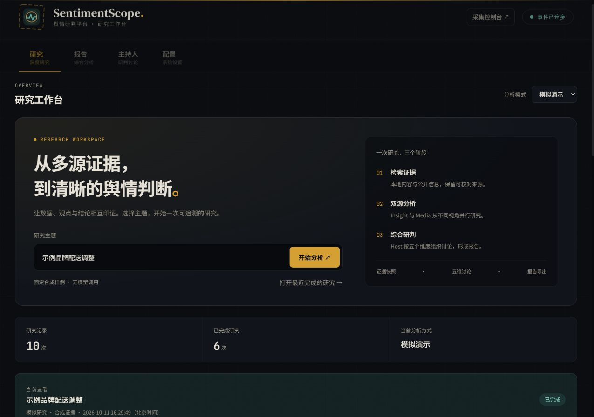
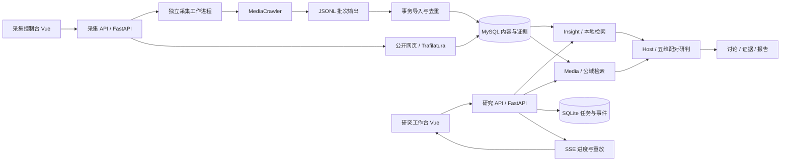

# SentimentScope · 舆情研判平台

[](https://github.com/GooChen55/SentimentScope/actions/workflows/ci.yml)


面向热点事件与品牌舆情的全栈应用：从社交内容和公开网页获取证据，通过多 Agent 协作完成研判，并提供可追溯的讨论记录与 HTML / Markdown 报告。

项目重点是让一次分析具备完整的任务生命周期：**采集 → 检索 → 双源分析 → 主持人研判 → 证据核对 → 报告导出**。当前采用 Python / FastAPI + Vue，支持 Windows 本机运行。

[架构说明](docs/architecture.md) · [使用指南](docs/guides/usage.md) · [安装与验证](docs/development.md) · [采集指南](docs/guides/crawler.md)

## 界面预览



研究工作台提供主题输入、Agent 进展、证据评测与历史筛选；采集控制台提供数据概览、任务创建和诊断。两套界面均支持窄屏布局。截图展示模拟模式与合成示例，不代表真实模型质量。

## 解决什么问题

舆情分析往往需要在社交评论、新闻报道和模型生成结果之间反复切换，也容易遇到来源难核对、任务刷新后丢失、同主题报告混用等问题。

SentimentScope 将采集和研究组织为两个独立应用，共享内容数据库。研究工作台展示分析进度、角色产物、讨论与证据，采集控制台负责登录采集、任务诊断、进度和入库；所有研究产物绑定具体任务。

## 核心能力

| 能力 | 当前实现 |
| --- | --- |
| 社交与网页采集 | 关键词任务、登录会话保留、实时计数、停止与重试；公开网页正文提取和关联话题 |
| Insight Agent | 检索本地内容与评论，分析讨论重点、情绪观点和平台差异 |
| Media Agent | 搜索公开信息并读取本地网页证据，梳理媒体叙事与公开观点 |
| Host Agent | 按五个维度配对两侧章节，组织讨论并形成综合研判 |
| 证据与报告 | 按研究任务保存证据快照、三个角色报告与讨论；预览和导出 HTML / Markdown |
| 任务与评测 | 持久化历史、取消与重新研究、SSE 事件重放；引用编号与维度覆盖检查 |

五个研判维度：事件背景与概览、舆情热度与传播、公众情感与观点、平台与群体差异、深层原因与影响。维度定义集中在 [研究契约](apps/research-api/engines/contracts/dimensions.py)。

## 架构与技术栈



| 层次 | 技术与用途 |
| --- | --- |
| 前端 | Vue 3、Vite；采集前端使用 TypeScript / Tailwind CSS |
| API 与编排 | Python 3.12、FastAPI、asyncio、LangGraph |
| 数据与持久化 | MySQL、SQLAlchemy、SQLite；JSONL 采集交换与文件产物 |
| 采集 | MediaCrawler、Playwright、Trafilatura |
| 模型与检索 | 可配置模型 Provider、公开搜索服务；默认 MySQL 多通道检索与规则聚类 |
| 工程 | pytest、依赖锁文件、Docker Compose、PowerShell 启停与检查脚本 |

研究 API、采集 API 和采集引擎各自使用独立 Python 环境，避免依赖冲突。两个 API 通过数据库交换证据，采集引擎通过子进程适配，不混入研究服务进程。

## 关键工程设计

| 问题 | 设计与取舍 | 代码入口 |
| --- | --- | --- |
| 两侧分析如何协作 | Insight / Media 异步并行运行；Host 监听章节事件，按维度配对研判 | [研究编排](apps/research-api/engines/orchestration/research.py)、[Host 图](apps/research-api/engines/host_agent/graph.py) |
| 同主题多次研究如何隔离 | 使用 `research_id` 关联上下文、证据、事件和产物；报告绑定具体任务 | [研究任务服务](apps/research-api/app/services/managed_research.py) |
| 刷新或断线如何查看进度 | SQLite 保存事件序号；SSE 按任务与 `Last-Event-ID` 重放，连接发送心跳 | [事件接口](apps/research-api/app/routers/events.py)、[任务存储](apps/research-api/app/services/research_store.py) |
| 重复采集如何控制入库 | 以平台、记录类型和远端 ID 标识记录，在事务中更新内容表与采集台账 | [导入服务](apps/crawler-api/app/deep_sentiment/ingest.py) |
| 采集停止后如何清理浏览器 | 独立工作进程、超时控制与 Windows Job Object 管理进程树 | [任务管理](apps/crawler-api/app/web/services/task_manager.py)、[进程管理](apps/crawler-api/app/web/services/process_job.py) |
| 如何区分演示与真实质量 | 模拟与真实任务明确标记；基础结构检查和需要人工参考答案的 RAGAS 评测分别运行 | [基础评测](apps/research-api/app/services/evaluation_service.py)、[RAGAS 说明](apps/research-api/evaluation/README.md) |

## 验证情况

以下为本机开发环境已有验证结果，不代表吞吐量基准或模型准确率：

- 后端测试 **39 项通过**：研究服务 15 项、采集服务 24 项；两套前端生产构建通过。
- 微博关键词“考研趋势”真实采集完成，新增入库 **26 条内容、128 条评论**。其他平台适配器已检查导入，登录采集尚待逐个平台验证。
- 真实主题“考研趋势”已完成 Insight / Media / Host 研究与报告落盘。
- 已检查历史任务、SQLite 完整性与 **14 个报告下载**，下载内容与保存文件一致。
- 公开网页正文入库、重复更新与 Media Agent 本地证据读取已验证。

测试入口：[研究测试](apps/research-api/tests)、[采集测试](apps/crawler-api/tests)。检查工具见 [check_project.py](tools/check_project.py)；本机结果写入 `var/runtime/`，不上传用户数据。

## 快速开始

需要 Git、Python 3.12、Node.js、uv，以及已启动的 Docker Desktop。当前脚本面向 Windows PowerShell。

```powershell
git clone https://github.com/GooChen55/SentimentScope.git
cd SentimentScope
```

首次使用先按 [安装指南](docs/development.md) 创建 `config/*.env`、安装应用依赖并初始化采集引擎，再启动：

```powershell
.\Start.ps1
```

| 入口 | 地址 |
| --- | --- |
| 研究工作台 | http://127.0.0.1:3000 |
| 采集控制台 | http://127.0.0.1:5173 |
| 研究 API 文档 | http://127.0.0.1:5001/docs |
| 采集 API 文档 | http://127.0.0.1:9000/docs |

停止应用：`.\Stop.ps1`；数据库已运行时可用 `.\Start.ps1 -SkipDatabase`。停止应用保留数据库、历史产物与浏览器登录状态。仓库当前为私有，克隆需要访问权限。

### 演示流程

1. 在研究工作台选择“模拟演示”，使用固定主题“示例品牌配送调整”开始分析，无需调用模型。
2. 查看两侧 Agent 产物与主持人五维讨论，展开证据并核对引用。
3. 生成报告，预览或下载 HTML / Markdown，再从历史任务打开结果。
4. 展示真实采集时，在采集控制台填写关键词并完成平台登录，查看实时计数、入库结果和任务诊断。真实研究还需配置模型与搜索服务。

日常检查：`.\scripts\check.ps1`，包括测试、前端构建、采集引擎浏览器检查与服务检查，需要应用和数据库可用。真实模型连通性、真实爬取和 RAGAS 评分单独执行，不混入常规测试。

## 目录组织

```text
SentimentScope/
├── apps/
│   ├── research-api/      研究任务、Agent、证据、报告与评测
│   ├── research-web/      研究工作台
│   ├── crawler-api/       采集调度、工作进程、去重与入库
│   └── crawler-web/       采集控制台
├── config/               环境配置示例；本机密钥不提交
├── infra/                Compose 与数据库初始化
├── vendor/               采集引擎与内容表结构
├── scripts/              安装、启动、停止与检查
├── tools/                服务与数据完整性检查
├── docs/                 架构、开发与使用指南
└── var/                  本机运行数据，不提交
```

## 当前边界与后续方向

当前为本机单实例部署，同一时间执行一个研究任务，采集任务串行运行。尚未实现用户鉴权、分布式队列、多实例恢复与生产部署；服务重启会标记中断任务，不会自动续跑。

默认关闭 Milvus 向量检索和语义模型聚类。网页采集暂不支持需要登录、验证码或脚本渲染的页面。基础引用检查仅确认编号存在，不能证明事实正确；RAGAS 适配器已提供，但尚未产生真实评分。

后续可在现有任务与证据契约上扩展鉴权、队列调度、可恢复执行和人工标注评测集。当前项目不包含 Java 业务层。

## 第三方组件

社交采集使用 MediaCrawler，公开网页提取使用 Trafilatura，RAGAS 适配参考评测仓库实现。项目工程内容集中在研究编排、任务与事件持久化、采集适配、证据入库、报告和两个工作台之间的业务流程。

来源、版本和许可见 [第三方说明](THIRD_PARTY_NOTICES.md)。MediaCrawler 采用非商业学习许可，使用时需遵循上游条款；所有第三方版权和许可证均保留。

## 开发与反馈

开发约定、检查命令和 PR 要求见 [贡献指南](CONTRIBUTING.md)。普通故障与功能建议可通过仓库 Issues 模板反馈，敏感信息处理见 [安全说明](SECURITY.md)。GitHub CI 自动执行后端测试、前端构建和仓库检查；真实采集与模型评测仍需本机单独验证。
