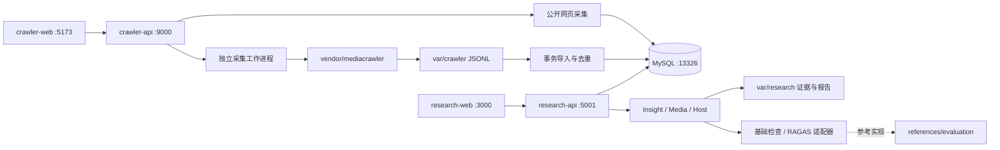

# 架构与模块职责

本项目采用一个仓库管理多个应用。研究与采集保持独立进程，通过共享 MySQL 内容表交换证据；两套前端分别调用自己的 API。研究任务和采集批次分别持久化，报告与证据按任务隔离。

## 应用边界

| 应用 | 负责 | 运行环境 |
| --- | --- | --- |
| `apps/research-api` | 研究任务、SSE、Agent 编排、证据检索、讨论、报告与评测 | 独立 Python 3.12 `.venv` |
| `apps/research-web` | 研究、主持人讨论、报告与模型配置界面 | 独立 Vue / Vite 应用 |
| `apps/crawler-api` | 任务状态、采集进程生命周期、实时计数、网页采集、去重入库 | 独立 Python 3.12 `.venv` |
| `apps/crawler-web` | 采集配置、实时进度、历史与重试 | 独立 Vue / Vite 应用 |

两个 API 都有自己的 `app` 包，因此分别运行和测试，避免在一个 Python 进程中混合导入。研究 API 的 `app` 负责 HTTP 与任务服务，`engines` 负责 Agent 逻辑、事件和证据契约；采集 API 的 `app/web` 负责接口和任务，`app/deep_sentiment` 负责采集适配及导入，`app/db` 负责数据库。

## 数据与配置的所有权

| 位置 | 内容 / 写入者 |
| --- | --- |
| `config/research.env` | 模型、搜索及研究配置；研究 API 配置接口持久化到这里 |
| `config/crawler.env` | 采集参数与可选话题提取模型 |
| `config/database.env` | 本机 MySQL 配置；Compose 和统一启动脚本共同读取 |
| `config/crawler-database.json` | 控制台保存的数据库配置；统一本机启动默认使用 `database.env` |
| `var/research/tasks.sqlite3` | 研究任务与事件历史；研究 API |
| `var/research/runs/<research_id>/` | 按任务隔离的证据及三个角色产物 |
| `var/research/report/combined/` | 可下载的 HTML / Markdown；报告服务 |
| `var/research/evaluation/` | 人工参考样本和评测输出 |
| `var/crawler/tasks.json` | 持久化采集任务；采集 API |
| `var/crawler/crawl-runs/<batch>/` | 原始 JSONL、引擎日志与安全诊断 |
| `var/browser/mediacrawler/` | 平台浏览器配置与登录状态；官方引擎 |
| `var/logs/research/` | Agent 日志 |
| `var/runtime/` | 四个服务日志、进程记录、迁移备份与检查结果 |

路径由两个 API 各自的 `paths.py` 集中定义，基于文件所在位置计算工作区根目录。研究任务按 `research_id` 隔离，采集批次按 UUID 隔离；不能用目录位置推断采集结果成功。

## 第三方与历史代码

- `vendor/mediacrawler`：唯一实际执行社交采集的引擎，提交固定在采集 API 的 `crawler-engine.lock.json`；原 Git 历史与许可证保留，本地适配器不改上游源码。
- `vendor/content-schema`：兼容内容表定义及其许可证，仅用于建表兼容。通过 `app/db/content_schema.py` 加载，不向全局导入路径注入整个旧爬虫。
- `references/evaluation`：评估优化仓库的 `0119` 分支参考实现；正式适配器在研究 API 的 `evaluation/` 中。
- `archive`：完整旧爬虫、旧维护脚本、原示例测试和 macOS 压缩包元数据，保留来源，不参与启动、测试或部署。

## 当前部署边界

启动脚本只管理本项目四个应用，保留固定 Compose 项目名和 MySQL 命名卷。当前是本机单实例部署，采集任务串行执行；尚未实现分布式队列、用户鉴权和多实例恢复。RAGAS 需要独立配置与人工参考答案，尚未产生真实 RAGAS 评分。
